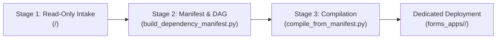

# Integrating External Application Repositories with the Workbench & Testbed

This reference describes how **Oracle Forms Workbench** operates as an authoring, analysis, and containerized testbed for external Oracle Forms applications, how to configure the environment, and how strict workspace isolation is maintained between the public workbench and external project repositories.

---

## 1. Architectural Model & Sibling Layout

The workbench repository (`oracle-forms-workbench`) provides the native Rust developer UI, binary extraction, parser/diff engines, and the containerized Oracle Fusion Middleware 14c reference stack. External applications consuming the workbench reside in their own repositories outside this project:

```text
/home/<user>/source/ (or C:\Users\<user>\source\repos\)
├── oracle-forms-workbench/          (Public tooling: Rust server, 14c testbed, compiler scripts)
│   ├── crates/                      (Native Rust Workbench source, port 7070)
│   ├── oracle-reference-stack/      (Oracle Forms 14c & Database containers)
│   ├── plugins/oracle-forms/        (Batch compiler automation, skills, and tools)
│   └── start_testbed.py             (Master services startup script)
│
└── <external-app-repo>/             (Private application source repository)
    ├── <source-dir>/                (Application .fmb, .pll, .mmb, and XML sources)
    └── <analysis-outputs>/          (Application-specific business rules, playbooks, logs)
```

In Windows WSL2 environments:
- Workbench: `/mnt/c/Users/<user>/source/repos/oracle-forms-workbench`
- External Application: `/mnt/c/Users/<user>/source/repos/<external-app-repo>`

---

## 2. Environment Configuration (`.env`)

Configure the connection between repositories in the git-ignored `.env` file at the root of `oracle-forms-workbench` (template in `example.env`):

```ini
# Path to external application source directory (treated as strictly read-only)
OFW_FORMS_PATH_EXTRA=../<external-app-repo>/<source-dir>

# External working directory for staging, generated XML, and compiler logs (on Linux ext4)
OFW_WORK_DIR=/home/<user>/oracle_home_14c/ofw-work

# Oracle Home directory on the host (mounted into containers as /oracle_home_14c)
OFW_ORACLE_HOME=/home/<user>/oracle_home_14c

# Default database connection string for compilation and preview
OFW_PREVIEW_DB_LOGON=<account>/<password>@<db-alias>
```

> [!IMPORTANT]
> **Filesystem Performance on Windows WSL2:**  
> Keep `OFW_WORK_DIR` and `OFW_ORACLE_HOME` on Ubuntu's native ext4 filesystem (`/home/<user>/...`), never on the Windows 9P mount (`/mnt/c/...`). Staging and compiling on ext4 reduces WebLogic startup from 15–45 minutes down to ~2 minutes and eliminates 9P file-locking issues.

---

## 3. Starting All Services (`start_testbed.py`)

Run `start_testbed.py` from the **Ubuntu WSL2 shell** at the root of `oracle-forms-workbench`:

```bash
cd /mnt/c/Users/<user>/source/repos/oracle-forms-workbench
python3 start_testbed.py
```

### Services Managed:
1. **Podman Runtime (`/run/user/<uid>`):** Verifies tmpfs permissions. After a Windows reboot or `wsl --shutdown`, the script prompts for the WSL `sudo` password to recreate the directory (`sudo chmod 1777 /run/user/<uid>`).
2. **Oracle Database 23ai Free (`oracle23ai-lite`):** Starts on port `1521` (SID: `FREE`).
3. **Oracle Forms 14.1.2 (`forms-server-14c`):** Starts WebLogic and the Forms servlet on port `7001` (`http://localhost:7001/forms/frmservlet`).
4. **Rust Workbench Server (`oracle-forms-server`):** Compiles and runs in the background on port `7070` (`http://127.0.0.1:7070`).

### Common Commands:

| Command | Action |
|---|---|
| `python3 start_testbed.py` | Full stack: Database (1521), Forms 14c (7001), Rust Workbench (7070) |
| `python3 start_testbed.py --status` | Non-destructive check of running containers, ports, and health |
| `python3 start_testbed.py --no-forms` | Fast mode: Database + Rust app only (skips WebLogic boot) |
| `python3 start_testbed.py --restart-rust` | Rebuilds and restarts the Rust server without touching containers |
| `python3 start_testbed.py --stop-forms` | Graceful 60-second shutdown of `forms-server-14c` |

---

## 4. The 3-Stage Compilation Pipeline for External Projects

External applications consume the batch compilation automation located in `plugins/oracle-forms/.apm/skills/compiling-and-running-oracle-forms/scripts/`:



### Path Shortcuts:
```bash
D=plugins/oracle-forms/.apm/skills/compiling-and-running-oracle-forms
M="$D/scripts/build_dependency_manifest.py"
C="$D/scripts/compile_from_manifest.py"
B=/home/<user>/oracle_home_14c/ofw-work/build
```

### Stage 1: Read-Only Intake & Staging
- All source files from `<external-app-repo>` are copied or synced into `<OFW_WORK_DIR>/source/`.
- The external repository's files are never modified, edited, or overwritten during batch compilation.

### Stage 2: Dependency Resolution & Case Sensitivity
```bash
python3 "$M" --source-dir /home/<user>/oracle_home_14c/ofw-work/source \
             --build-dir "$B"
```
- Traverses attached libraries (`<AttachedLibrary>`), parent forms, and object libraries.
- Compiles the dependency DAG into `build-manifest.json`.
- Detects mixed-case Linux filename lookups (e.g., `UtilLib.plx` vs `utillib.plx`) and records them in `requiredSymlinks`.

### Stage 3: Dependency-Ordered Compilation
```bash
# Compile specific modules or wildcards against target DB
python3 "$C" --build-dir "$B" --types FMB --app-name <app_name> --modules "orders*,cust*"

# Compile all uncompiled modules in dependency order
python3 "$C" --build-dir "$B" --types PLL,MMB,FMB --skip-compiled --app-name <app_name>
```
- **In-Memory Credentials:** Prompts once via `getpass` and passes credentials to `frmcmp_batch` in-memory. Passwords are never written to disk or logs.
- **Symlink Management:** Automatically materializes `requiredSymlinks` in `stage/` and the runtime deployment folder.
- **Warning-Tolerant:** Layout warnings (`FRM-32093`, `FRM-30410`) with `Created form file ...fmx` are recorded as compiled.

---

## 5. Dedicated Runtime Segregation (`forms_apps/<app_name>/`)

To prevent multiple external applications from colliding or overwriting core product files:
1. **Dedicated Application Directory:**
   ```text
   /oracle_home_14c/forms_apps/<app_name>/
   ```
   Compiled `.plx`, `.mmx`, and `.fmx` binaries deploy here.
2. **Configuration in `formsweb.cfg`:**
   In the AdminServer config, define an application section:
   ```ini
   [<app_name>]
   envFile=<app_name>.env
   webstart=enabled
   allowStaticHTML=true
   ```
3. **`FORMS_PATH` Precedence in `<app_name>.env`:**
   ```ini
   FORMS_PATH=/oracle_home_14c/forms_apps/<app_name>:/oracle_home_14c/forms
   ```
   This ensures application-specific binaries take precedence while stock product libraries remain fallback defaults.

---

## 6. Cross-Project Isolation Rules

When configuring the workbench for an external application, follow `.agent/rules/cross-project-isolation.md`:
1. **Zero Proprietary Assets in this Repository:** Never commit, copy, or stage external proprietary `.fmb`, `.pll`, `.mmb`, `.xml`, `.sql`, or `.jnlp` files into `oracle-forms-workbench`.
2. **Generic Patterns in Public Documentation:** Document only generalized mechanisms, command flags, and reproduction steps using generic placeholders (`<external-app-repo>`, `<app_name>`, `DEPT`, `EMP`).
3. **Application Logs & Playbooks Stay in the Client Repo:** Project-specific compile ledgers, schema mappings, database credentials, and business rule documentation must remain in `<external-app-repo>`.
